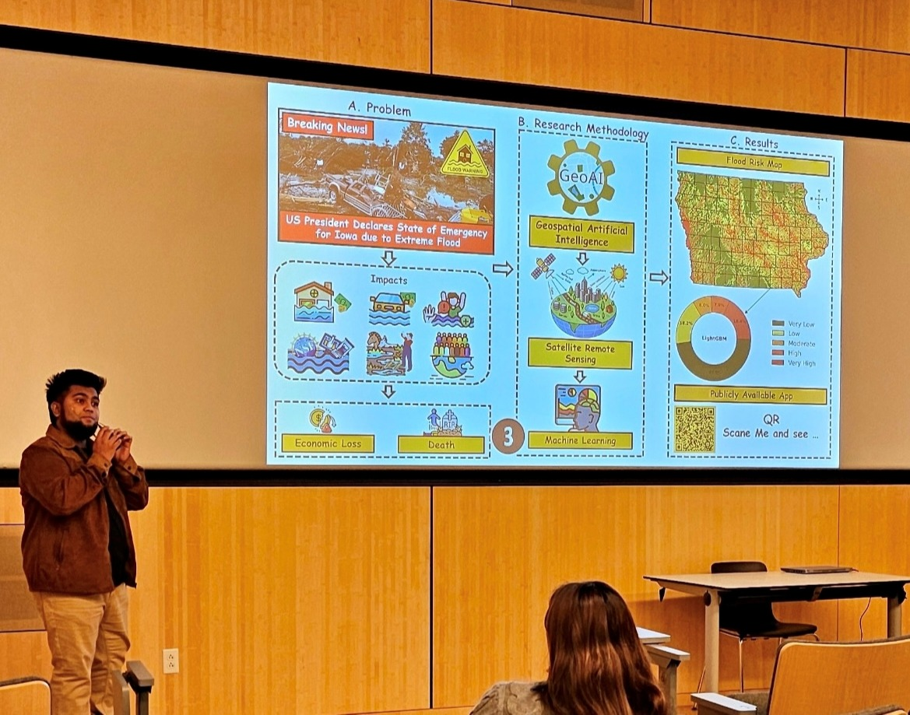

  

## Mirza Md Tasnim Mukarram , University of Iowa, United States

**Hydroclimatic Extremes | Machine Learning | Satellite Remote Sensing**  
**Disaster Risk Reduction & Early Warning Systems**

I am a PhD researcher specializing in geospatial artificial intelligence (GeoAI), 
spatial machine learning, and satellite remote sensing for disaster risk reduction, 
hazard monitoring, and early warning systems.

 🎓 Affiliation: a. Department of Civil & Environmental Engineering b. Informatics, Department of Computer Science
 🛰️ Research focus: GeoAI, spatial ML, Earth observation analytics  
 🚨 Applications: flood risk mapping, drought monitoring, early warning systems  
 🧠 Methods: machine learning, deep learning, geospatial modeling  
 🤝 Open to collaboration on GeoAI, DRR, and decision-support research  
 📫 Contact: mtasnimmukarram@uiowa.edu  

🌐 Personal website: https://mirza9003.github.io

